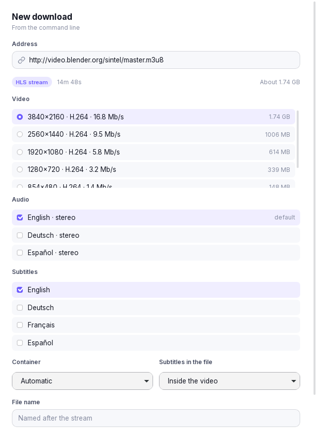
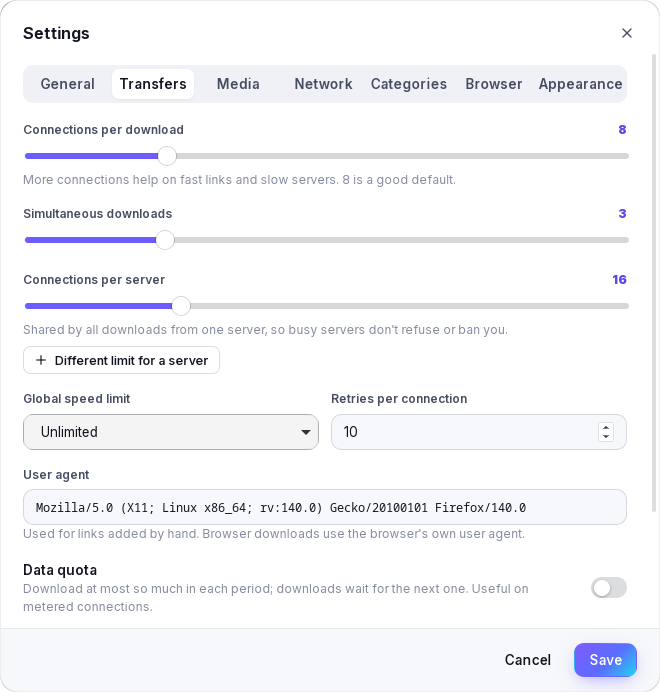
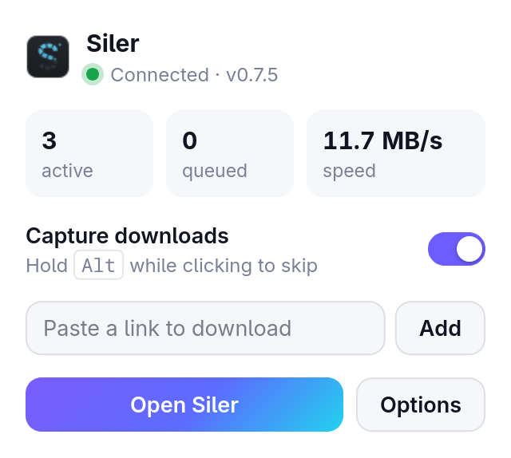

<div align="center">


# Siler

**A fast, beautiful download manager for Linux, with a Firefox extension that hands it your downloads and videos.**

[](https://github.com/sekhnat/Siler/releases/latest)
[](#install)
[](docs/browser-extension.md)
[](docs/architecture.md)
[](docs/architecture.md)

[**Download**](https://github.com/sekhnat/Siler/releases/latest) · [**Firefox extension**](docs/browser-extension.md) · [**Documentation**](#documentation)

<br>

<picture>
  <source media="(prefers-color-scheme: dark)" srcset="docs/images/main-dark.png">
  <source media="(prefers-color-scheme: light)" srcset="docs/images/main-light.png">
  
</picture>

</div>

## Highlights

**Fast and resilient**
- Segmented downloads over many connections, with dynamic splitting: a free connection takes over half of the largest remaining piece. The connection count can change while a download runs.
- Pause and resume across restarts and crashes; passing network failures are retried, honouring `Retry-After`.
- Mirrors and multi-source downloads, metalinks with piece hashes, and **Refresh link** for expired addresses without losing progress.

**Video and audio**
- HLS and DASH streams with a picker for quality, audio languages and subtitles, muxed into MP4 or MKV by a bundled FFmpeg, with no re-encoding.
- AES-128 streams and WebVTT/TTML subtitles, timed to the video. DRM-protected streams are refused.
- From the browser: YouTube, Vimeo, Facebook, Instagram, TikTok and any page that plays HLS, DASH or a video file.

**Browser integration**
- Firefox, LibreWolf, Waterfox, Floorp and Zen. Downloads are taken before Firefox's own dialog appears, with their cookies, referrer and form data.
- A **Download** button over videos, **Download all links**, a per-site switch, and a clear message whenever a download stays in Firefox.

**Organised and automated**
- Named queues with schedules, and an action when they finish: quit, sleep, hibernate or shut down.
- Categories with their own folders, numbered batches (`img[001-120].jpg`), import and export (links, JSON, metalinks, IDM `.ef2`), and clipboard monitoring.
- Keep files up to date, a site grabber that can also save pages for offline reading, and a command to run after each download.

**In control**
- Global and per-download speed limits, per-server connection limits and a data quota (so many MB every so many hours).
- Checksums (MD5 to SHA-512, and the server's `Digest` header), **Verify checksum…** for any file, and ZIP preview to fetch just the files you need from an archive.
- Proxies (system, HTTP, SOCKS5), and logins saved in the desktop keyring.

**At home on Linux**
- Starts with your session if you like, waiting in the tray; live status, notifications and sounds; keeps the computer awake while downloads run; drag finished files out of the list. Wayland and X11.

<table>
  <tr>
    <td align="center" valign="top" width="50%"><picture><source media="(prefers-color-scheme: dark)" srcset="docs/images/add-video-dark.png"><source media="(prefers-color-scheme: light)" srcset="docs/images/add-video-light.png"></picture><br><sub><b>Pick the quality, audio and subtitles of a stream</b></sub></td>
    <td align="center" valign="top" width="50%"><picture><source media="(prefers-color-scheme: dark)" srcset="docs/images/settings-dark.png"><source media="(prefers-color-scheme: light)" srcset="docs/images/settings-light.png"></picture><br><sub><b>Tune connections, limits and quotas</b></sub></td>
  </tr>
</table>

## Install

Siler runs on 64-bit Linux. Each [release](https://github.com/sekhnat/Siler/releases/latest) offers:

**AppImage (recommended)** — everything inside, including the browser host and FFmpeg.

```sh
chmod +x Siler-*-x86_64.AppImage
./Siler-*-x86_64.AppImage --install-integration   # menu entry, icons and the Firefox host
```

Keep the file where it is: the menu entry and the browser host point at it. To have Siler start when you log in, turn on Settings → General → **Start when you log in**. To update, use an AppImage updater (AppImageUpdate, Gear Lever, AppImageLauncher, AppManager): only the changed parts are downloaded. If you replace or move the file by hand, start it once.

**Tarball** — the same programs in a folder (`siler-<version>-linux-x86_64.tar.gz`). Unpack it where it will stay and run `./siler --install-integration`. It needs WebKitGTK 4.1, plus libayatana-appindicator for the tray.

## Firefox extension

<picture><source media="(prefers-color-scheme: dark)" srcset="docs/images/extension-popup-dark.png"><source media="(prefers-color-scheme: light)" srcset="docs/images/extension-popup-light.png"></picture>

1. In Siler, open Settings → Browser and click **Add to Firefox**. The AppImage and the tarball include the extension, signed by Mozilla. You can also download `siler-integration-<version>.xpi` from the [latest release](https://github.com/sekhnat/Siler/releases/latest) and open it with Firefox.
2. On the welcome page, grant access to all sites.

That's it: matching downloads now go to Siler. Hold **Alt** while clicking a link to let Firefox handle it, or turn capture off for a site from the toolbar popup. More in [Browser extension](docs/browser-extension.md).

<br clear="right">

## Quick start

```sh
siler https://example.com/file.iso                         # open the Add window for a link
siler --silent --dir ~/ISOs https://example.com/a.iso      # add without asking
siler --queue=Night --silent https://example.com/big.iso   # wait in the "Night" queue
siler --start-queue=Night                                  # …and start it later
siler --import links.txt                                   # links, metalinks, JSON or IDM .ef2
```

When Siler is already running, the command line goes to it. See [Using Siler](docs/usage.md) for every option and keyboard shortcut.

## Documentation

| Guide | What's in it |
| --- | --- |
| [Using Siler](docs/usage.md) | Adding downloads, the command line, queues and scheduling, keyboard shortcuts, logs and troubleshooting |
| [Video and audio streams](docs/media.md) | HLS and DASH, the picker, FFmpeg, output formats, subtitles and safety checks |
| [Browser extension](docs/browser-extension.md) | Installing, how capture works, videos on pages, site recognisers and signing your own build |
| [Architecture](docs/architecture.md) | How the pieces fit, the download engine, security and privacy, files on disk |
| [Development](docs/development.md) | Building from source, tests and the release process |

## Building from source

You need Rust (stable), Node.js with pnpm, and WebKitGTK 4.1 development files ([details](docs/development.md#requirements)).

```sh
git clone https://github.com/sekhnat/Siler.git && cd Siler
cargo test --workspace                     # engine and app tests
cd app && pnpm install && pnpm tauri dev   # run with hot reload
cd .. && ./scripts/install-dev.sh          # release build + desktop and Firefox registration
```

## Roadmap

- FTP and SFTP
- A Chromium extension
- Flatpak and AUR packages
- Start with the desktop session
- NTLM/Kerberos logins and proxy auto-config (PAC)

## License

Copyright © sekhnat. All rights reserved.

The source code is published so it can be read and reviewed; no license is granted to copy, modify or redistribute it.

Third-party components keep their own licenses:
- **FFmpeg**, bundled with releases, is LGPL-2.1-or-later and runs as a separate program. `scripts/build-ffmpeg.sh` builds it from the official release.
- The extension's YouTube solver is **yt-dlp/ejs** (Unlicense), with **meriyah** (ISC) and **astring** (MIT); see [`SOURCES.md`](extension/media/youtube/vendor/SOURCES.md).

## Acknowledgements

Siler is built with [Tauri](https://tauri.app), [Svelte](https://svelte.dev), [Rust](https://www.rust-lang.org) and [FFmpeg](https://ffmpeg.org). The site recognisers follow [yt-dlp](https://github.com/yt-dlp/yt-dlp)'s extractors. Icons by [Lucide](https://lucide.dev), type set in [Inter](https://rsms.me/inter/).
