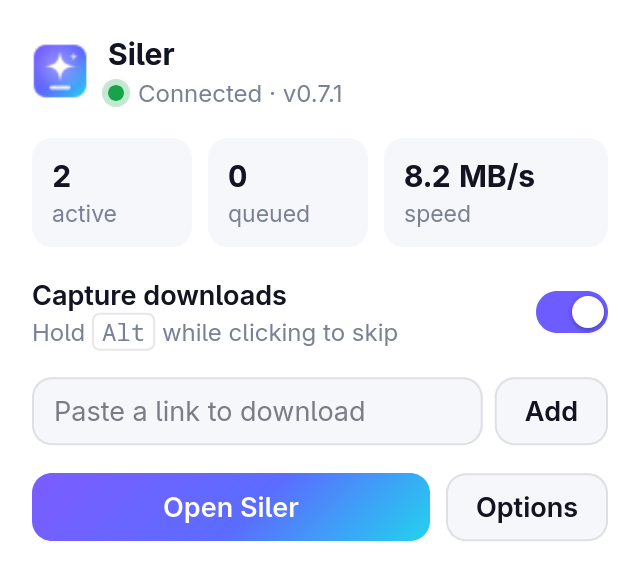

# Browser extension

**Siler Integration** sends downloads and the videos web pages play from Firefox to Siler. It works in Firefox and the browsers built on it: LibreWolf, Waterfox, Floorp and Zen.

  

## Installing

1. **Register the browser host.** Run `siler --install-integration` once, or open Siler → Settings → Browser → **Install**. The AppImage and the release tarball include the host; from a source checkout, `./scripts/install-dev.sh` builds and registers it (it needs `siler-nmhost` next to the `siler` binary).
   - The host manifest goes to `~/.mozilla/native-messaging-hosts/`, which Firefox, Zen and Floorp read. A copy goes to `~/.librewolf/`, `~/.waterfox/`, `~/.floorp/` and `~/.zen/` when those browsers are installed.
   - When Siler runs as an AppImage, the host is copied to `~/.local/share/siler/bin/`, because the AppImage's own files disappear when it closes. Siler updates that copy and the AppImage path on every start.
2. **Install the extension.** Open Siler → Settings → Browser and click **Add to Firefox**. The AppImage and the release tarball include the extension, signed by Mozilla; Siler hands Firefox a copy and Firefox asks to add it. Each [release](https://github.com/sekhnat/Siler/releases/latest) also has `siler-integration-<version>.xpi` to open with Firefox directly. A build you signed yourself (below) takes precedence.
3. **Grant access to all sites** on the welcome page. Firefox treats MV3 host permissions as optional.

### Signing your own build

Release builds of Firefox only keep signed extensions installed. To sign a changed extension:

1. Create an API key at <https://addons.mozilla.org/developers/addon/api/key/>.
2. Put it in `~/.config/siler/amo.env` (`AMO_JWT_ISSUER=…`, `AMO_JWT_SECRET=…`), then `chmod 600` it.
3. Raise `version` in `extension/manifest.json`: every signing needs a new version.
4. Run `./scripts/sign-extension.sh`. It uploads the extension for an **unlisted** signature: Mozilla signs it but doesn't publish it.
5. Click Siler → Settings → Browser → **Add to Firefox**.

For a quick test instead, open `about:debugging#/runtime/this-firefox`, choose **Load Temporary Add-on** and pick `extension/manifest.json`. It is removed when Firefox restarts. `npx web-ext run -s extension` also works, except on distributions that lock `devtools.debugger.remote-enabled`, such as CachyOS.

## Capturing downloads

- **Before Firefox sees it:** downloads are recognised from the response headers and cancelled before Firefox creates a download, so its dialog and download panel never appear.
- **Which downloads:** a download is handed over when its extension or MIME type matches the rules on the options page. "Capture everything" ignores the rules.
- **Bypassing:** hold **Alt** while clicking a link to let Firefox download it instead.
- **Cookies and context:** each download goes over with its cookies, referrer and user agent, so links that need a login keep working, including on resume.
- **Forms:** POST downloads are taken too. The form body (up to 1 MiB, file uploads excluded) is replayed for every connection.
- **New tabs:** a tab that was opened only for the download is closed once Siler has it.
- **Per site:** the toolbar popup has a "Capture on this site" switch.
- **Fallback:** if Siler can't be reached, the download stays in Firefox. If the hand-over fails, Firefox downloads it again itself. Either way a notification says why; this can be turned off in the options.
- **Download all links:** sends every link on the page or in the selection to Siler. Links that look like files are pre-selected, and the batch window can filter by type or name.
- **"Always ask where to save files":** if this Firefox setting is on, the hand-over happens after the save dialog.
- **Versions:** the extension and the app exchange a protocol version. If either is out of date, the popup, the options page and Siler's settings say which one to update.

## Videos on web pages

- **Finding them:** the extension watches what a page's player loads. HLS and DASH manifests (by address or content type) and whole video or audio files (512 KB and up; pieces of streams are skipped) are listed per tab, with their number on the toolbar button. An HLS master playlist is listed once, without the playlists it names.
- **Download button:** pointing at a video (240×135 or larger) shows a **Download** button at its top right. It runs in the extension's own world, in a closed shadow root, so pages can't style or script it. The popup's "Videos on this page" list and the right-click menu's **Download this video with Siler** do the same.
- **Hand-over:** the video goes to Siler's Add window with the page's cookies, referrer and user agent. A stream opens the quality, audio and subtitle picker; a file opens the usual form. The window says which site it came from.
- **Names:** videos are named by their title (slashes become "⧸", as yt-dlp writes them).

### Site recognisers

Each can be switched off in the options. They are ported from yt-dlp's extractors, which read the same data.

| Site | What Siler gets |
| --- | --- |
| **YouTube** | The extension asks YouTube's player API from the page, as the clients yt-dlp uses by default without a PO token (`tv_samsung`, then `visionos`). It finishes the signed links with YouTube's own player code, run by yt-dlp's [ejs](https://github.com/yt-dlp/ejs) solver inside a blank frame of the page. Before handing over, it checks that one link answers and falls back to the next client. Siler receives a DASH manifest of every format (up to 4K, H.264/VP9/AV1, AAC/Opus) with captions as WebVTT. It fetches the files in 10 MiB ranges, as yt-dlp does, and waits out a pre-roll ad when YouTube asks for that. |
| **Vimeo** | The player config's HLS stream, with its subtitle files. Videos whose owners turned on DRM are refused, like any DRM stream. |
| **Facebook**, **Instagram** | The DASH manifest the page's data carries (read from its embedded JSON and its GraphQL answers), or the plain video file when there is none. |
| **TikTok** | The best H.264 file of the video, with the page's cookies and referrer, which TikTok's servers require. |

The YouTube solver and its parser libraries are vendored unmodified in `extension/media/youtube/vendor/` by `scripts/vendor-extension-libs.sh`; `SOURCES.md` there lists versions, checksums and licenses.

### Limits

- DRM-protected videos are refused. Live streams aren't recorded.
- Links from a page expire (YouTube's after a few hours). A download whose links expired says so, and the video has to be sent from the page again.
- Content that needs a login works only when you are logged in in Firefox.
- Sites change their players; recogniser fixes come with extension updates.

## Notes for reviewers and developers

- **Mozilla review:** the YouTube solver compiles YouTube's player script with `Function`. `web-ext lint` reports this as `DANGEROUS_EVAL`, a warning that doesn't stop unlisted signing.
- **Tests:** `node --test extension/tests/` checks the request rules and each recogniser against recorded, scrubbed answers in `extension/tests/fixtures/`. The app's DASH parser reads the same YouTube manifest snapshot in its own tests.
- **Protocol 2:** the extension 0.3.0 and the app 0.6.0 (and later) speak protocol 2, which adds video details to a hand-over. An older app still takes plain downloads.
