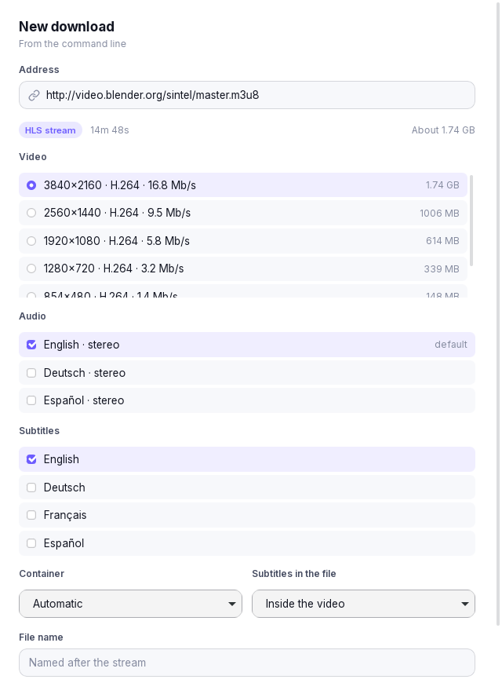

# Video and audio streams

Siler downloads HLS (`.m3u8`) and DASH (`.mpd`) streams into one ordinary video file, with the quality, audio languages and subtitles you pick.

  

## Adding a stream

- Paste a stream's address into the Add window, give it on the command line, or copy it (the clipboard watcher offers it).
- From a web page, the Firefox extension finds the streams and files a page plays and hands them over with the page's cookies. See [Videos on web pages](browser-extension.md#videos-on-web-pages).
- Siler lists the video qualities, audio languages and subtitles, with the size each choice will take, and downloads the ones you pick into one file.
- Settings → Media sets the defaults: the highest quality to pick, preferred audio and subtitle languages, the container and where subtitles go.

## FFmpeg

- Streams are muxed with **FFmpeg**, with no re-encoding. Siler ships a static build made from a pinned release by `scripts/build-ffmpeg.sh`, with only the codecs, containers and filters it needs.
- `scripts/install-dev.sh` builds it the first time and puts `ffmpeg` and `ffprobe` next to the app. The AppImage and the release tarball include it.
- Without FFmpeg, single-track downloads still work; combining video and audio needs it.
- Settings → Media shows which FFmpeg is in use. `SILER_FFMPEG=/path/to/ffmpeg` overrides it.
- The bundled build enables nothing that needs `--enable-gpl`, so it is LGPL-2.1-or-later. It runs as a separate program. The build checks the release tarball against a pinned SHA-256; its PGP signature can be checked by hand.

## Output

- Output is MP4 when every codec fits it, and MKV otherwise (Opus audio, VP9, unknown codecs, or subtitles kept inside the file). The Add window says why.
- Subtitles go inside the file by default, or beside it as `<name>.<language>.vtt`.
- WebVTT and TTML subtitles are read from plain files and from inside MP4 (`wvtt`, `stpp`, which Siler reads itself because FFmpeg can't), and timed to the video. No cue runs past the end of the picture and sound, so the subtitles never make the file longer.
- AES-128 streams are decrypted as they download, including encrypted initialisation segments (`EXT-X-MAP` under an `EXT-X-KEY`). Each key is fetched once and kept only in memory.

## How a stream downloads

- The manifest is read again at every attempt, so expired signed links are replaced by the playlist's own refresh.
- Downloaded pieces are kept in a hidden work folder (`.<name>.siler.media`) beside the output until it is published, and never fetched twice.
- FFmpeg reads each track's pieces in order through a named pipe (under `$XDG_RUNTIME_DIR/siler/media/`), so no joined copy is written. If a track can't be read from a pipe (an MP4 with its index at the end), Siler joins it into one file and runs FFmpeg again.
- The pieces stay until the output is written, so a download needs about twice the stream's size on disk at the end.

## Safety

- A manifest's own links must be `http(s)`, and by default may not point at this computer or the local network. Settings → Media can allow it, for a media server at home.
- Names are checked in the same lookup the connection uses, so a name can't pass the check with a public address and then connect to a private one (DNS rebinding). A proxy on this computer still works.
- Redirects are followed one hop at a time, and each hop is checked the same way.
- The cookies and headers the browser sent go only to the stream's own site, not to other servers its playlist names.
- DRM-protected streams are refused, and Siler never contacts a license server.

## Not supported yet

Live streams, HDS, generic playlists, SAMPLE-AES, and subtitles carried inside WebM.

## Testing

See [Development → Media tests](development.md#media-tests) for the fixture streams and the optional test against real CDNs.
